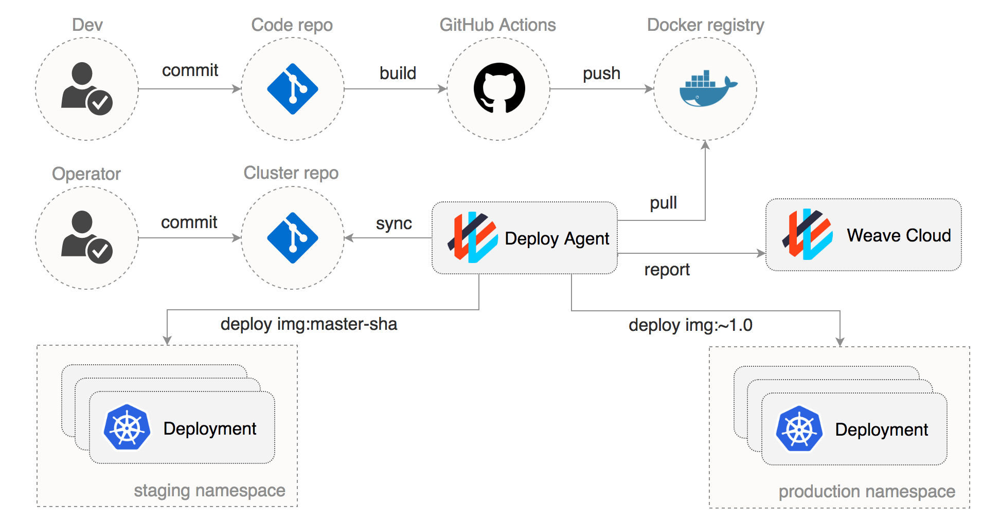
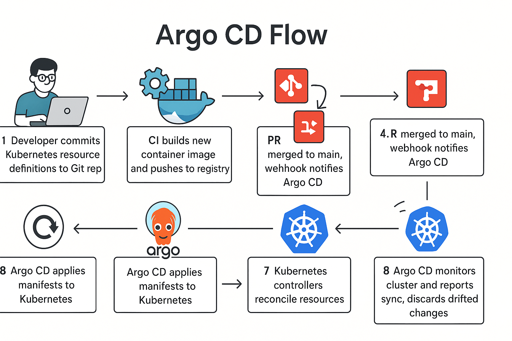

# Challenge 5 - GitOps

[< Previous Challenge](./04-scaling.md)&nbsp;&nbsp;&nbsp;&nbsp;&nbsp;&nbsp;&nbsp;&nbsp;[Next Challenge>](./06-service-mesh.md)

## Introduction

GitOps is a term coined by WeaveWorks for implementing Continuous Delivery for Cloud Native applications. The core concept is using a Git repository as the source of truth for the desired state of infrastructure and applications. Flux and Argo CD implement GitOps for Kubernetes by reconciling the cluster with the desired state in Git.

Choose one of the following options to complete this challenge:

- **Option 1 - Flux:** Use the Azure-managed Flux v2 cluster extension on your existing AKS cluster.
- **Option 2 - Argo CD:** Use the Azure-managed Argo CD cluster extension on your existing AKS cluster.

## Description

### Option 1 - Flux

Credit: <https://www.weave.works/blog/why-is-a-pull-vs-a-push-pipeline-important>

- Enable Azure-managed Flux v2 on your cluster
    - HINT: [Deploy applications using GitOps with Flux v2](https://learn.microsoft.com/en-us/azure/azure-arc/kubernetes/tutorial-use-gitops-flux2?tabs=azure-cli)
- Create a Flux configuration that tracks your Git repository
    - Use one kustomization for your application manifests

### Option 2 - Argo CD

Credit: <https://www.freecodecamp.org/news/from-commit-to-production-hands-on-gitops-promotion-with-github-actions-argo-cd-helm-and-kargo/>

- Enable Azure-managed Argo CD on your cluster
    - HINT: [Deploy applications using GitOps with Argo CD](https://learn.microsoft.com/en-us/azure/azure-arc/kubernetes/tutorial-use-gitops-argocd)
- Access the Argo CD UI and create an Application that tracks your Git repository
    - Enable automatic synchronization

### For either option

- Create your own GitHub repository with manifests for a `demo` namespace, a basic Deployment, and a Service
- Configure your chosen GitOps tool to deploy the manifests from your repository
    - If the repository is private, give the tool read access; do not commit credentials
- Make a small change to the Deployment in Git and verify the change in the cluster
    - Example: Change the container image or replica count
- Expose the application using app routing from [Challenge 2 - Helm](./02-helm.md)

## Success Criteria

- By only changing your GitHub repository, you have done the following:
    - Created a new namespace `demo`
    - Created a Deployment and Service in the `demo` namespace
    - Made a change to the Deployment and verified the change in the cluster
- Your application is accessible through app routing
- Your Flux configuration reports **Compliant**, or your Argo CD Application reports **Synced** and **Healthy**

## Optional Challenge

For either Flux or Argo CD:

- Use a Helm chart in your Git repository instead of plain deployment manifests
- Configure your chosen GitOps tool to deploy the chart
- Change the chart or its values in Git and verify the change in the cluster
