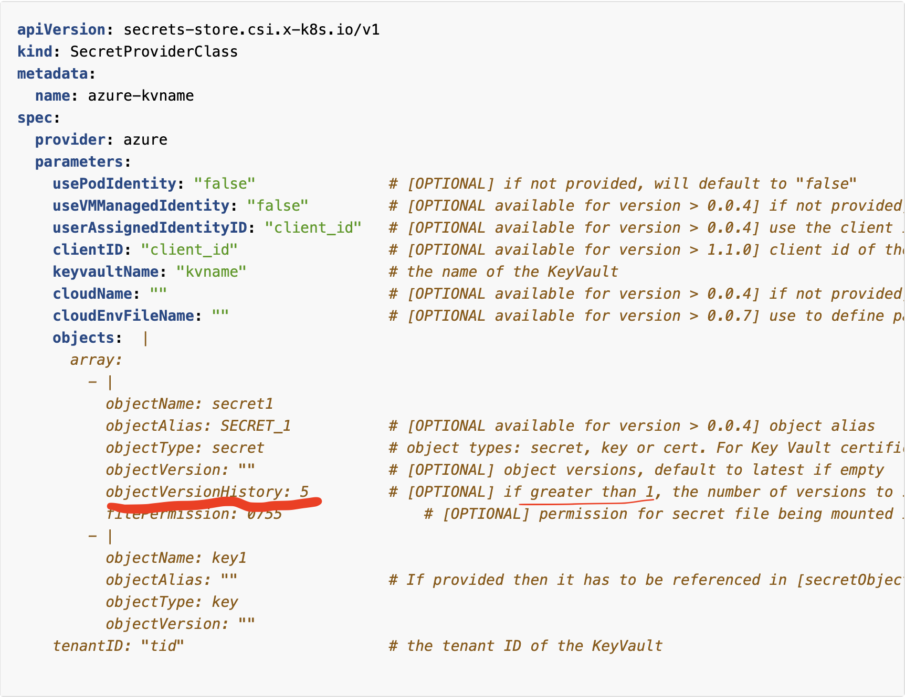

# Challenge 04 - Secrets and Configuration Management - Coach's Guide 

[< Previous Solution](./Solution-03.md) - **[Home](./README.md)** - [Next Solution >](./Solution-05.md)

## Notes and Guidance

The goals of this challenge focus on managing configuration settings and secrets for the ["Whoami"](../Student/Resources/) sample application in Kubernetes. 

There are two non-secret configuration settings:
  - Database server name
  - Database user name

There is one secret value:
  - Database password

## Solution Guide

There are multiple ways to solve this challenge. Depending on the organization's learning goals, you should encourage the students to complete it each of the ways so that they are familiar with the options and pros/cons of each one.

For the non-secret configuration settings, this challenge can be solved using either of the following:
- [Kubernetes ConfigMaps](https://kubernetes.io/docs/concepts/configuration/configmap/)
  - This link explains the ConfigMap concept and has examples that should guide students on how to get this to work.
- Azure App Configuration Service

For the secret value, this challenge can be solved using any of the following:
- [Kubernetes Secrets](https://kubernetes.io/docs/concepts/configuration/secret/) (not ideal)
  - **Warning:** Kubernetes Secret values are base64-encoded, not encrypted by that encoding. Encryption at rest depends on the platform and configuration. Users authorized to read Secrets, or create Pods that consume them, can access their values.
- Azure Key Vault CSI Driver for Kubernetes
  - Pull secrets from Key Vault and store in Kubernetes Secrets (and keep them in sync)
    - Pro: Enables applications that look for secrets in Environment Variables to run without application modification.
    - Con: This is subject to the same warning above for Kubernetes Secrets themselves.
    - Con: Need to configure synchronization scheduled to keep Key Vault secrets in-sync with Kubernetes Secrets.
  - Pull secrets from Key Vault and mount them as a storage volume on the pod(s). **RECOMMENDED OPTION**
    - Pro: Avoids storing the secret value in a Kubernetes Secret; authorized processes in the consuming pod can read the mounted file.
    - Con: Multiple identity options can lead to confusion when configuring Azure Key Vault CSI driver to pull secrets from Azure Key Vault. See below for more details.

The challenge states that no static passwords should be used or stored on the cluster.  This implies a managed identity is needed to access Azure Key Vault.

**Microsoft Entra Workload ID (Workload Identity) is the preferred and most secure approach for this challenge's AKS-to-Key Vault authentication.** Federate a dedicated user-assigned managed identity to the API's Kubernetes service account. This provides workload-scoped access without storing a client secret or sharing a node-level identity.

Other identity options include a system-assigned identity assigned to the AKS control plane or a user-assigned identity assigned to the node pool VMSS. These are broader than the dedicated workload identity and are not recommended for this solution.

### Secrets Lecture

For help explaining how secrets are managed in Kubernetes, you can present the optional lecture for this challenge in the [AKS Enterprise-Grade Lectures](Lectures.pptx) presentation deck.

- The presentation slides have several animations that build out the complexity of each option for handling secrets in Kubernetes.
- The presentation has speaker notes that should help you speak to each slide.

### Sample Solution YAML Files

We have included two sample YAML files that demonstrate how to solve this challenge:

[secretproviderclass.yaml](./Solutions/Challenge-04/secretproviderclass.yaml) - This file configures:
  - The Azure Key Vault CSI Driver to retrieve a secret named `sqlpassword` from Key Vault, and mount it as a file named `SQL_SERVER_PASSWORD`.
  - This file has placeholders that must be replaced with the workload identity's client ID, as well as the Key Vault name and tenant ID.

[api_akv.yaml](./Solutions/Challenge-04/api_akv.yaml) - This file configures:
  - A Kubernetes ConfigMap to store the database name and database admin name.
  - The API pod to retrieve the database name and admin name from the Kubernetes Config Map
  - A `sqlapi` service account annotated with the workload identity's client ID, selected by the API pod with the `azure.workload.identity/use: "true"` pod label.
  - The CSI Driver volume for consumption
  - The API pod to mount the CSI Driver volume at a `mountPath` named `/secrets`

You can find these files in the [Solutions/Challenge-04](./Solutions/Challenge-04/) folder of this hack's coach guide.

## Azure Key Vault CSI Driver Documentation

Here are links to relevant documentation:
- [Using the Azure Key Vault Provider](https://azure.github.io/secrets-store-csi-driver-provider-azure/docs/getting-started/usage/)
  - This link has the definitive guide to all of the settings in the SecretProviderClass manifest.
- [Use the Azure Key Vault Provider for Secrets Store CSI Driver in an AKS cluster](https://learn.microsoft.com/en-us/azure/aks/csi-secrets-store-driver)
  - This is a good overview of the whole process, but then has you switch context midway through the document to the link below regarding how to choose one of the different identity types for access to Azure Key Vault.
- [Provide an identity to access the Azure Key Vault Provider for Secrets Store CSI Driver](https://learn.microsoft.com/en-us/azure/aks/csi-secrets-store-identity-access)
  - Follow the Workload Identity instructions for the recommended solution.
- [Troubleshoot Azure Key Vault Provider for Secrets Store CSI Driver](https://learn.microsoft.com/en-us/troubleshoot/azure/azure-kubernetes/troubleshoot-key-vault-csi-secrets-store-csi-driver)

### Gotchas!

Below are some common hang ups that we have encountered with students completing this challenge.

#### Creating the Azure Key Vault

Students may create an Azure Key Vault using either the Azure Portal or the Azure CLI.  Coaches should always encourage students to use the CLI and save the commands they run so that they end up with a re-usable script which is infrastructure-as-code.

It is common that students forget to authorize the identity used by the CSI Driver. For an RBAC-enabled vault, grant the workload identity the **Key Vault Secrets User** role; for a vault using access policies, grant secret `get` permission.

#### Choosing the Correct Azure Identity

Students may get hung up on choosing the correct identity to use for accessing Azure Key Vault from the CSI Driver on the AKS cluster.

Coaches should recommend Workload Identity with a dedicated user-assigned managed identity. Enable the AKS OIDC issuer, Workload Identity, and Key Vault CSI add-on. Create a federated identity credential with the cluster's OIDC issuer, subject `system:serviceaccount:default:sqlapi`, and audience `api://AzureADTokenExchange`. If using a different namespace, update the subject and deploy the service account and manifests into that namespace.

Use the same managed identity client ID in the service account annotation and SecretProviderClass `clientID`. Mount the password directly; do not configure `secretObjects` synchronization into a Kubernetes Secret for this challenge.

#### Mounting Azure Key Vault Secrets as a File Volume

When using the CSI Driver to mount secrets as a File Volume, the default behavior is that files named with the secret names are placed in the mount path, with the content of each file being the value of the secret.

For example, if the CSI Driver is configured to bring back secrets named `secretname1`, `secretname2`, and `secretnameX`, you will observe the following on the pod's file system:

```
/mountpath/secretname1
/mountpath/secretname2
/mountpath/secretnameX

cat secretname1
Pa55w0rd123!
```
In the SecretProviderClass manifest for the CSI Driver, you can optionally specify to bring back multiple versions of a secret (if there are multiple versions in Azure Key Vault).

For example:



When bringing back multiple versions of a secret, the CSI Driver will create a sub-folder named with the secret name in the mount path. The sub-folder will then contain one or more files named with numbers 0 through the number of versions returned.

For example, if the CSI Driver is configured to bring back 3 versions of a secret named `secretname1`, you will observe the following on the pod's file system:

```
/mountpath/secretname1/0
/mountpath/secretname1/1
/mountpath/secretname1/2

cd /secretname1

cat 0
Pa55w0rd123!
cat 1
myDogzName2008
cat 2
myKidzName2020
```

This behavior requires the application to know to look in different locations for the secret value if there are multiple versions of the secret supplied.

**NOTE:** The sample "whoami" application is NOT coded to handle this difference. If students accidentally configure the CSI Driver to bring back multiple versions of a secret, the application will not find it. Coaches should be on the look out for this scenario, advise students of this behavior, and how to fix it.
